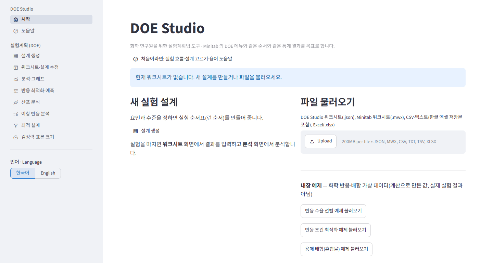
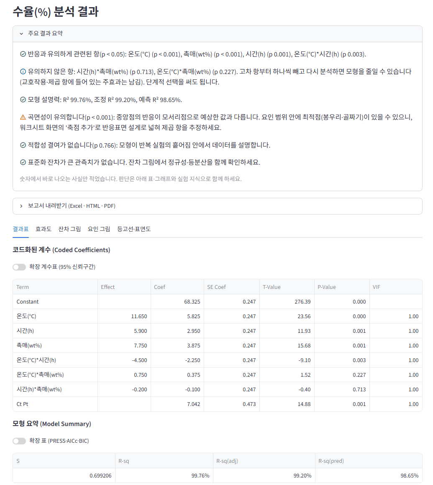
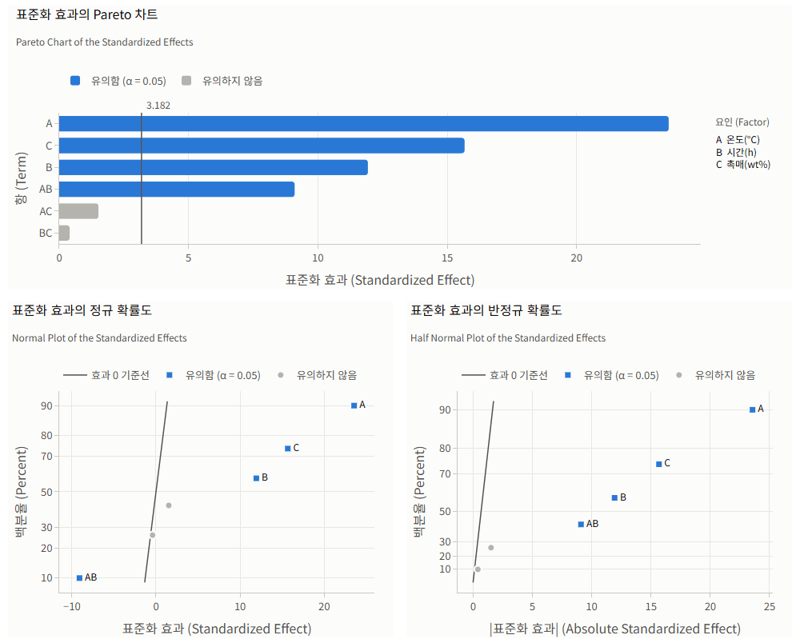
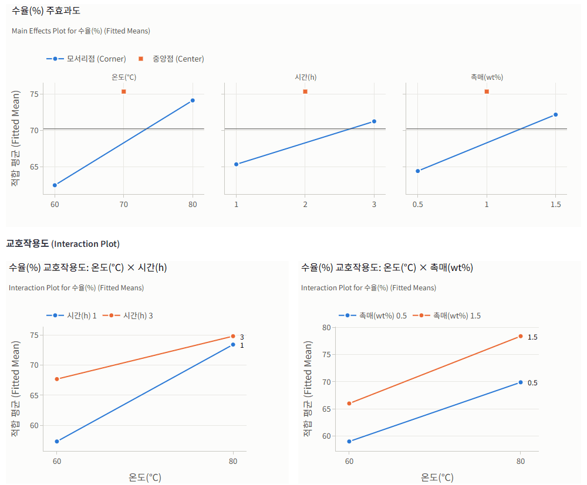
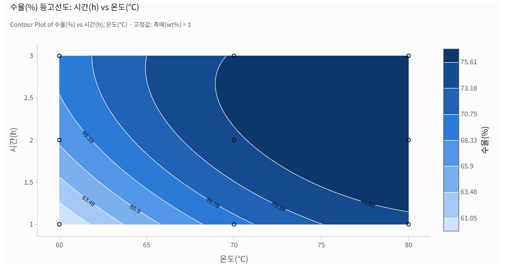
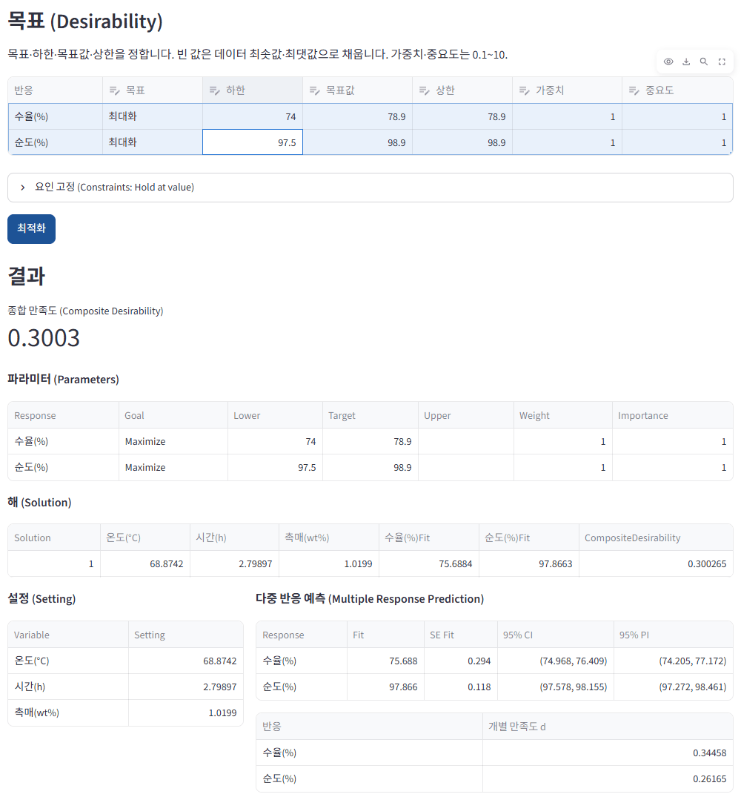
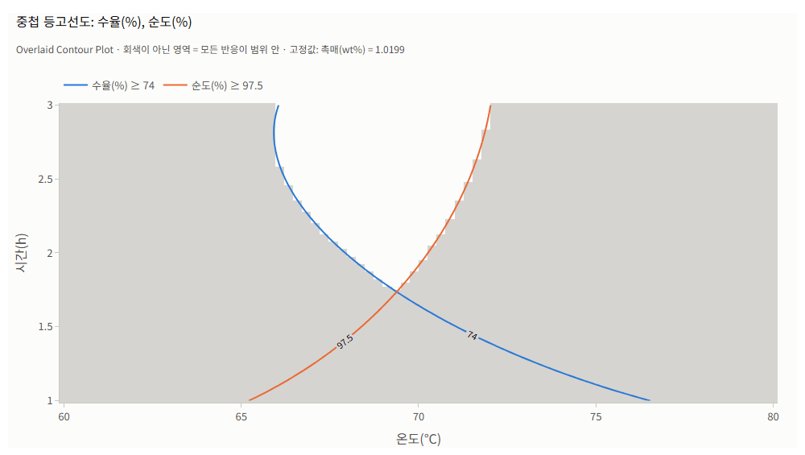
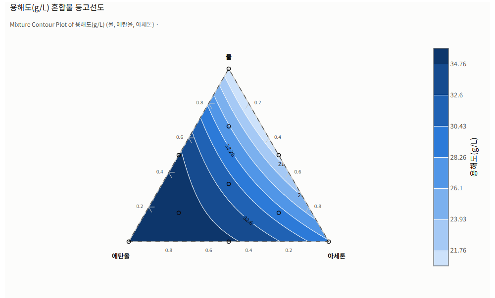

# DOE Studio

화학 연구원을 위한 **실험계획법(DOE) 웹앱**입니다. 실험 설계 → 결과 입력 → 분석 → 반응표면 → 최적 조건 찾기 → 보고서까지 브라우저에서 합니다.
Minitab 의 `Stat > DOE` 메뉴와 **같은 순서, 같은 통계 결과(표의 숫자)** 를 내는 것을 목표로 합니다.



- 결과 숫자는 Minitab 공식 문서의 예제 출력표와 **표시 자릿수까지 글자 단위로** 대조해 검증합니다([검증](#검증)).
- 이름·로고·도움말 문구·화면 디자인은 Minitab 것을 쓰지 않습니다.
- 화면은 한국어·English 를 사이드바에서 바꿀 수 있고, 그래프와 보고서도 선택한 언어를 따릅니다.

## 주요 기능

| 단계 | 할 수 있는 것 |
|---|---|
| **설계** | 2수준 완전·부분요인(생성자·별칭 구조·블록·중앙점), Plackett-Burman, 일반 완전요인, 반응표면(중심합성 CCD·Box-Behnken), 혼합물(단순 중심·단순 격자·극꼭지점, 공정 변수), 확정적 선별설계, 2수준 분할구, D-최적 설계, Taguchi(직교배열 21종) |
| **설계 수정** | 접기, 반복 추가, 랜덤화, 축점 추가(추가 전 실제 값 미리보기) |
| **분석** | 계수표·모형 요약·분산분석(곡면성·적합성 결여), 단계적 선택, Box-Cox 변환, 가중 회귀, 산포 분석(표준편차), 이항 반응(로지스틱), **주요 결과 요약**(유의한 항·곡면성·다음 단계 안내) |
| **그래프** | 효과도(Pareto·정규·반정규), 잔차 4종, 주효과·교호작용·입방체도, 등고선·표면도, 혼합물 삼각 등고선·반응 추적 그림 |
| **최적화** | 예측(신뢰·예측구간), 중첩 등고선, 반응 최적화(만족도, 여러 반응 함께, 평균+표준편차·확률을 쓰는 강건 설계), 혼합물 배합 최적화 |
| **그 밖** | 검정력·표본 크기, 보고서 내려받기(Excel·HTML·PDF), 파일 불러오기(DOE Studio JSON·Minitab .MWX·CSV·Excel), 작업 자동 저장 |

## 화면 둘러보기

아래 화면은 앱에 들어 있는 **내장 예제(가상 화학 데이터)** 로 만든 것입니다. 온도·시간·촉매가 반응 수율에 주는 영향을 보는 실험입니다.

### 분석 — 주요 결과 요약과 결과표

표를 읽기 전에 무엇을 봐야 하는지 문장으로 알려 줍니다. 이 예에서는 곡면성이 유의하니 축점을 추가해 반응표면 설계로 넓히라고 안내합니다.



### 효과도와 요인 그림

<table>
  <tr>
    <td width="50%"></td>
    <td width="50%"></td>
  </tr>
  <tr>
    <td>Pareto 차트(오른쪽에 요인 이름표), 정규·반정규 확률도</td>
    <td>주효과도(모서리점·중앙점), 교호작용도</td>
  </tr>
</table>

### 반응표면 — 등고선도

축점을 추가한 중심합성설계(17런)로 2차 모형을 적합한 뒤, 두 요인에 대한 수율의 등고선을 그립니다.



### 반응 최적화 — 수율과 순도를 함께

분석 화면에서 적합한 모형을 그대로 써서(Minitab 의 저장 모형과 같음) 여러 반응의 목표를 함께 만족하는 조건을 찾습니다. 중첩 등고선도에서 흰 영역이 '수율 ≥ 74 %, 순도 ≥ 97.5 %' 를 모두 만족하는 범위입니다.

<table>
  <tr>
    <td width="50%"></td>
    <td width="50%"></td>
  </tr>
</table>

### 혼합물 — 용매 배합

물·에탄올·아세톤 배합비에 따른 용해도를 삼각 등고선으로 봅니다.



## 빠르게 시작하기

Python 3.11 이상이 필요합니다.

```powershell
git clone https://github.com/pcw7/doe-studio.git
cd doe-studio
python -m pip install -e .[report]   # report: PDF 보고서(reportlab)와 그래프 그림(kaleido)
streamlit run app/main.py            # 브라우저에서 http://localhost:8501
```

처음이라면 시작 화면의 **내장 예제 → '반응 수율 선별 예제 불러오기'** 로 아래 흐름을 따라 해 보세요. 화면 왼쪽의 **도움말**에는 실험 흐름, 목적별 설계 고르기, 결과 읽는 법, 용어 설명이 있습니다.

## 실험 흐름

1. **설계 생성** — 요인과 수준(예: 온도 60~80 °C)을 정하면 런 순서표가 나옵니다. Excel·CSV 로 내보내 실험 기록지로 씁니다.
2. **워크시트** — 반응 열(예: 수율)을 추가하고 결과를 입력합니다. 엑셀에서 붙여 넣어도 됩니다.
3. **분석·그래프** — 주요 결과 요약에서 유의한 항과 곡면성을 확인하고, 필요하면 항을 빼서 모형을 줄입니다.
4. **곡면성이 유의하면** 워크시트 → 설계 수정 → **축점 추가**로 반응표면 설계로 넓히고, 추가된 런을 실험해 다시 분석합니다.
5. **반응 최적화·예측** — 반응마다 목표(최대화·최소화·목표값)와 범위를 정하면 최적 조건과 예측구간이 나옵니다.
6. **보고서 내려받기** — 각 화면에서 Excel·HTML·PDF 보고서를 받습니다.

## 데이터 불러오기와 저장

| 형식 | 설명 |
|---|---|
| DOE Studio 워크시트(`.json`) | 설계 정보와 결과를 함께 저장·불러오기 |
| Minitab 워크시트(`.mwx`) | 열 데이터를 읽어 설계로 정의 |
| CSV·텍스트 | 한글 윈도우 엑셀의 'CSV(쉼표로 분리)'(cp949), 'CSV UTF-8', 유니코드 텍스트, 세미콜론 구분 모두 |
| Excel(`.xlsx`) | 시트 선택, 워크시트 Excel 내보내기 |

- **이미 해 둔 실험 데이터**도 분석할 수 있습니다. 파일을 올리고 요인 열을 고르면 2수준 요인·반응표면·확정적 선별·혼합물·일반 완전요인·Taguchi 가운데 어떤 설계인지 알아봅니다.
- **작업 자동 저장**: 워크시트(설계·입력한 결과)는 바뀔 때마다 이 컴퓨터의 `~/.doe_studio/autosave` 에 저장됩니다. 새로 고치거나 창을 닫은 뒤에는 시작 화면의 **이전 작업 이어서 하기**로 되살립니다(최근 20개 보관).
  - 저장 폴더는 환경 변수 `DOE_STUDIO_AUTOSAVE_DIR` 로 바꿉니다.
  - 여러 사람이 함께 쓰는 서버에 올릴 때는 `DOE_STUDIO_AUTOSAVE=0` 으로 끕니다. 저장 폴더가 컴퓨터에 하나라 다른 사람의 작업이 목록에 보이기 때문입니다.

## 검증

- Minitab 공식 문서의 예제 출력표 49개를 정답지(`tests/fixtures/minitab_docs/`)로 두고, 계수표·분산분석표·모형 요약·설계표 등을 **표시 자릿수까지 글자 단위로** 비교합니다.
- Minitab 예제 원자료(.MWX)로도 같은 결과가 나오는지 확인합니다. 원자료는 재배포할 수 없어 저장소에 없고, `python research/fetch_samples.py` 로 각자 내려받습니다. 파일이 없으면 해당 테스트와 시작 화면의 Minitab 예제는 건너뜁니다.
- 문서에 숫자 예제가 없는 기능(단계적 선택, Box-Cox, 이항 반응 등)은 statsmodels·scipy 로 따로 구현한 결과와 대조합니다.
- `python -m pytest` — 테스트 383개.

## 폴더 구조

| 경로 | 내용 |
|---|---|
| `doe_core/` | 순수 Python 엔진. 화면과 분리되어 단독으로 쓰고 테스트할 수 있음 |
| `doe_core/designs/` | 설계 생성(요인·반응표면·혼합물·선별·분할구·최적 설계·Taguchi)과 설계 수정 |
| `doe_core/analysis/` | 모형 적합, 분산분석, 효과도 통계, 단계적 선택, Box-Cox, 산포·이항 분석, 주요 결과 요약 |
| `doe_core/optimize/` | 예측, 반응 최적화(만족도 함수), 혼합물 최적화 |
| `doe_core/plots/` | 그래프(plotly), 라이트/다크 테마, 영어 변환 |
| `doe_core/report/` | 보고서(Excel·HTML·PDF) |
| `doe_core/io/` | 워크시트 저장·불러오기, CSV·Excel·Minitab .MWX 읽기, 자동 저장 |
| `doe_core/examples.py` | 내장 예제(가상 화학 데이터) |
| `app/` | Streamlit 화면. 진입점 `app/main.py`, 화면은 `app/views/` |
| `tests/` | pytest. `tests/fixtures/minitab_docs/` 에 Minitab 문서 예제의 출력표(정답지) |
| `research/` | 문서·예제 데이터 수집 도구 |
| `assets/readme/` | 이 문서의 화면 그림 |

## 개발

```powershell
python -m pip install -e .[dev,report]
python research/fetch_samples.py   # Minitab 문서 예제 데이터(.MWX) 내려받기(선택)
python -m pytest
streamlit run app/main.py
```

## 진행 상태

<details>
<summary>단계별 체크리스트 펼치기</summary>

- [x] 0단계: Minitab DOE 문서 조사(226편), 메뉴 트리(en/ko), 예제 출력표 픽스처 48개, 기능 요약 A/B/C, 사양서
- [x] 1단계: 2수준 요인설계 생성·분석(분산분석표, 효과도, 잔차)
  - [x] 2수준 완전·부분요인 생성 엔진(카탈로그 49행 검증, 생성자·정의관계·별칭·블록·중앙점·랜덤화) — 테스트 15개 통과
  - [x] Plackett-Burman(12~48런, 생성열 직교성 검증, 문서 예제 설계표 일치)
  - [x] 일반 완전요인(요인별 임의 수준, 텍스트·숫자 수준 값, 반복 블록)
  - [x] 설계 수정(접기, 반복 추가, 재랜덤화, 번호 재부여, 요인 수정, 설계 표시)
  - [x] 워크시트 저장·불러오기(JSON/CSV), 사용자 2수준 설계 정의, MWX → 워크시트
  - [x] 요인설계 분석: 계수표·모형 요약·분산분석(곡면성·적합성 결여)·비코드화 회귀식 — Minitab 예제와 글자 단위 일치
  - [x] 진단(이상 관측치·영향력 측도), 효과도 통계(Lenth PSE), 분석 시 별칭 구조, 평균 표
  - [x] 그래프: 효과도(Pareto·정규·반정규), 잔차 4종, 주효과·교호작용·입방체도(라이트/다크)
  - [x] 화면: 시작(파일 불러오기·예제), 설계 생성, 워크시트·설계 수정, 분석·그래프
- [x] 2단계: 반응표면(CCD·Box-Behnken), 등고선·표면도, 반응 최적화기
  - [x] CCD·Box-Behnken 생성, 축점 추가
  - [x] 반응표면 분석(완전 2차 모형 등) — SealStrength 예제와 글자 단위 일치
  - [x] 예측(Predict), 등고선·표면도·중첩 등고선
  - [x] 반응 최적화기(만족도 함수, 다중 반응)
  - [x] 화면: 반응표면 설계 생성·축점 추가·분석·등고선, 반응 최적화·예측, 예제 데이터 2종
- [x] 3단계: 혼합물, 확정적 선별설계, 최적설계, 분할구
  - [x] 혼합물 설계 생성(단순 중심·단순 격자·극꼭지점, 공정 변수)
  - [x] 혼합물 분석(Scheffé 모형 6종·역항·공정 변수, 비율·유사성분·양 단위) — FondueRecipe 예제와 글자 단위 일치
  - [x] 확정적 선별설계 생성·분석 — 8요인 예제 설계표, ultrasonic_cleaner 분석 예제와 글자 단위 일치
  - [x] 최적 설계(D-최적 선택·증강·평가, 거리 기반) — CrystalGrowth 예제 3개와 선택 순서·통계량 일치
  - [x] 2수준 분할구 설계 생성·분석(전구 오차·하위구 오차 분리)
  - [x] 화면: 혼합물·DSD·분할구 생성, 혼합물·선별·분할구 분석, 최적 설계 페이지, 예제 데이터 3종 추가
  - [x] 혼합물 예측·그래프(단순체 설계도, 반응 추적 그림, 삼각 등고선·표면도·중첩 등고선)
  - [x] 혼합물 반응 최적화(성분 합·범위·선형 제약, 공정 변수, 고정값)
- [ ] 4단계: 보고서 내보내기, 한/영 전환, 시범 사용 피드백
  - [x] 보고서 내보내기: Excel(.xlsx, 의존성 없음)·HTML(그래프 포함, 한 파일)·PDF(reportlab, 한글 글꼴 내장) — 설계·분석·최적화·최적 설계 화면
  - [x] 한/영 화면 전환(사이드바), 그래프·보고서도 선택한 언어로
  - [x] Taguchi 설계(직교배열 21종, S/N 비·평균 분석, 반응표, 주효과도, 예측)
  - [x] 단계적 모형 선택(Stepwise·Forward·Backward·AICc/BIC 정보 기준, 계층 규칙, 단계별 표)
  - [x] Box-Cox 변환(최적 λ·신뢰구간, 예측·최적화는 원래 단위로)
  - [x] 산포 분석(표준편차 전처리, ln(s) 최소제곱·최대우도, Ratio Effect)과 가중 회귀
  - [x] 이항 반응 분석(로지스틱: 이탈도 표, 오즈비, 적합도 검정, Hosmer-Lemeshow)
  - [x] 강건 설계: 반응 최적화기에 산포(표준편차)·이항(확률) 모형 함께 넣기
  - [x] 이항(확률)·산포(표준편차) 모형의 등고선도·표면도
  - [x] 결과 저장(적합치·잔차 등 워크시트 열), 확장 계수표(신뢰구간), 모든 관측치 표
  - [x] 검정력·표본 크기(2수준·Plackett-Burman·일반 완전요인, 검정력 곡선)
  - [x] Excel(.xlsx) 불러오기(사용자 설계 정의)·워크시트 Excel 내보내기
  - [x] 사용자 일반 완전요인·Taguchi 설계 정의(다수준 데이터)
  - [x] 가중 회귀·산포 분석·이항 반응·혼합물에서도 단계적 모형 선택
  - [x] 도움말 화면(실험 흐름·목적별 설계 고르기·결과 읽기·용어·자주 묻는 질문)
  - [x] 실사용 점검 반영(화학 반응 수율 시나리오, PR #42~#48)
    - [x] 한글 엑셀 CSV(cp949)·유니코드 텍스트·세미콜론 구분 불러오기
    - [x] 작업 자동 저장·복구(새로 고침·창 닫기·서버 재시작 뒤 '이전 작업 이어서 하기'), 파일 불러오기 무한 반복 수정
    - [x] 반응 최적화·예측이 분석 화면에서 적합한 모형(항 선택·단계적·Box-Cox·가중치)을 그대로 쓰기(Minitab 저장 모형)
    - [x] 워크시트: 25행까지 펼친 표, 열 이름 바꾸기·삭제, 설계 수정 결과 안내, 축점 실제 값 미리보기
    - [x] 분석 결과 주요 결과 요약(유의한 항·설명력·곡면성·적합성 결여·큰 잔차와 다음 단계 안내, 보고서에도)
    - [x] 그래프: 범례 겹침 해소, Pareto 요인 이름표, 영어 화면·보고서에서 '온도(°C)' 같은 이름 보존
    - [x] 내장 예제(가상 화학 데이터: 반응 수율 선별·반응 조건 최적화·용매 배합) — Minitab 예제 파일 없이도 따라 하기, 다중 선택 안내 한글화
  - [x] README 화면 그림(내장 예제로 만든 실제 화면)

</details>
